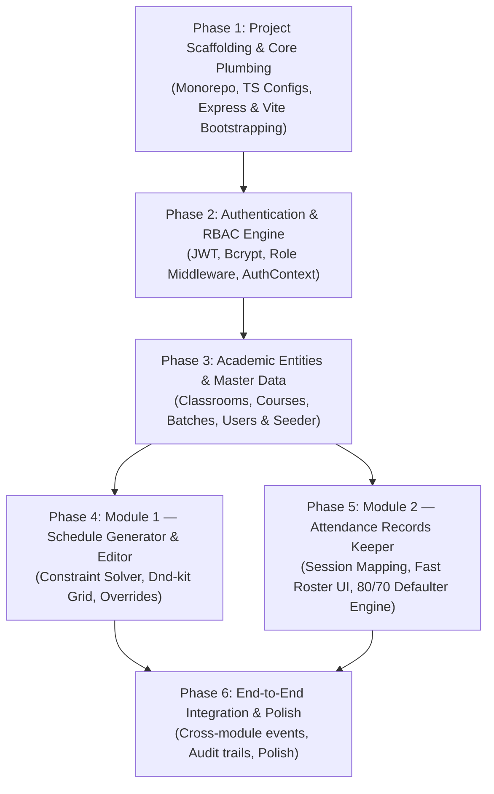
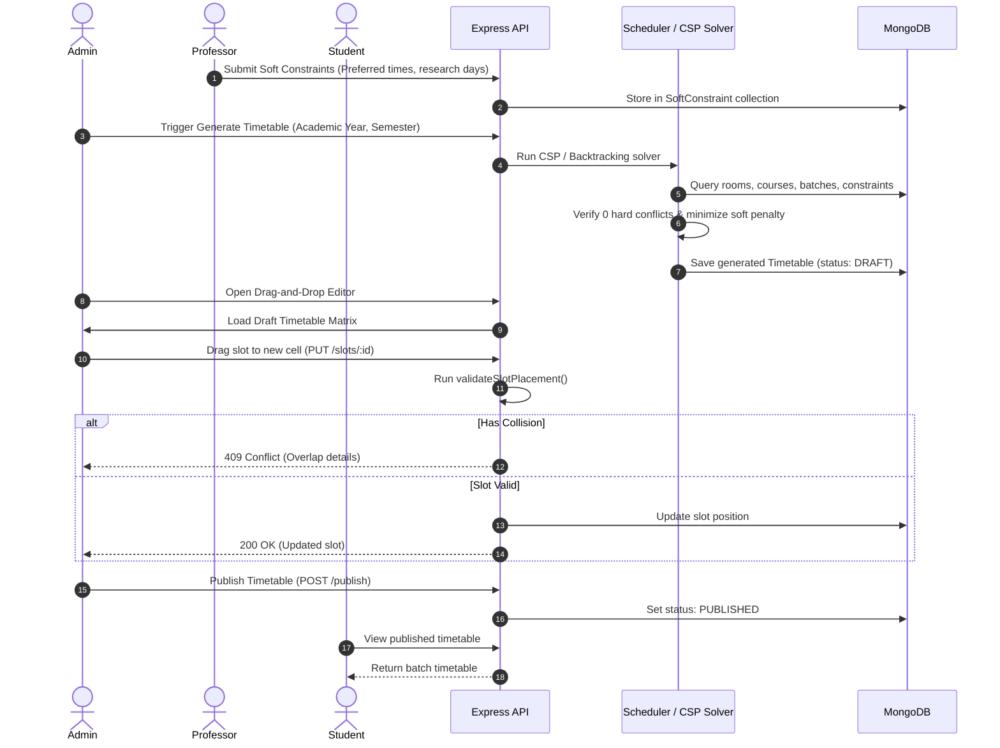

# Smart Academic Manager (SAM) — Initial Setup & Implementation Plan

> **Note:** This plan translates the architectural specifications in `CLAUDE.md` into actionable engineering phases. As noted, `CLAUDE.md` serves as a baseline reference and specifications can be tuned as development evolves.

---

## Executive Summary & Milestones Overview

---

## Phase 1: Project Scaffolding & Core Plumbing

### 1.1 Root Repository Setup
- Initialize root `package.json` with npm workspaces (`server` and `client`) or concurrently managed scripts.
- Setup `.gitignore` (node_modules, dist, .env, build artifacts).
- Setup root scripts:
  - `npm run dev` (runs both server and client concurrently).
  - `npm run install:all` (installs dependencies in both workspaces).
  - `npm run test` (executes backend & frontend test suites).

### 1.2 Backend Scaffolding (`server/`)
- Initialize Node.js TypeScript project:
  - Dependencies: `express`, `mongoose`, `dotenv`, `cors`, `helmet`, `jsonwebtoken`, `bcryptjs`, `zod`, `morgan`.
  - Dev Dependencies: `typescript`, `@types/node`, `@types/express`, `ts-node-dev`, `jest`, `supertest`.
- Setup `server/tsconfig.json` with strict mode, path aliases (`@/*` -> `src/*`).
- Core infrastructure files:
  - `src/config/env.ts`: Zod-validated environment schema (PORT, MONGO_URI, JWT_SECRET, etc.).
  - `src/config/db.ts`: Robust Mongoose connection with retry logic and connection pooling.
  - `src/middlewares/error.middleware.ts`: Central error handler mapping Zod errors, Mongoose duplicate key errors (E11000), and custom HTTP exceptions to a unified response envelope.
  - `src/utils/response.ts`: Standardized JSON responder: `{ success: boolean, data?: T, message?: string, errors?: any[] }`.
  - `src/server.ts` & `src/app.ts`: Clean separation of Express app config and server listening logic.

### 1.3 Frontend Scaffolding (`client/`)
- Initialize Vite + React 18 with TypeScript template:
  - Dependencies: `react`, `react-dom`, `react-router-dom`, `@tanstack/react-query`, `zustand`, `axios`, `lucide-react`, `date-fns`, `clsx`, `tailwind-merge`.
  - Drag-and-Drop: `@dnd-kit/core`, `@dnd-kit/utilities`, `@dnd-kit/modifiers`.
  - Styling: Tailwind CSS configured with CSS variables and responsive breakpoints.
- Setup `client/tsconfig.json` with `@/*` path aliases pointing to `src/*`.
- Setup Axios client wrapper with base URL (`http://localhost:5000/api/v1`) and auth token interceptors.
- Setup React Router with layout shells (AdminLayout, ProfessorLayout, StudentLayout, AuthLayout).

---

## Phase 2: Authentication & RBAC Core Infrastructure

### 2.1 Backend Auth & RBAC
- **User Model (`User.ts`):**
  - Fields: `email`, `passwordHash`, `firstName`, `lastName`, `role` (`ADMIN` | `PROFESSOR` | `STUDENT`), `departmentId`, `batchId` (for students), `rollNumber`, `isActive`.
  - Unique index on `email`, sparse index on `rollNumber`.
- **Security Services:**
  - Password hashing and verification using `bcryptjs` (salt rounds: 12).
  - JWT generation: Access Token (15m - 1d configurable) + Refresh Token (7d).
- **Middlewares:**
  - `auth.middleware.ts`: Decodes and validates JWT bearer tokens, attaches user context to `req.user`.
  - `rbac.middleware.ts`: `authorize(['ADMIN', ...])` to restrict endpoints based on authenticated role.
- **Auth Routes (`/api/v1/auth`):**
  - `POST /login`: Validates credentials, returns JWT token + user summary.
  - `POST /refresh`: Issues fresh token.
  - `GET /me`: Returns authenticated profile and permissions.
- **Admin Seeder Script (`server/src/utils/seeder.ts`):**
  - CLI command `npm run seed:admin` to create default institutional admin if none exists.

### 2.2 Frontend Auth Experience
- `AuthContext` / `useAuthStore` (Zustand):
  - Stores token, user object, active role, and authentication status.
  - Handles persistent login state via `localStorage` / HTTP cookies.
- Protected Route component (`ProtectedRoute.tsx`):
  - Enforces authentication and role verification.
  - Redirects unauthenticated users to `/login` and unauthorized roles to a friendly 403 Forbidden page.
- Login Page (`pages/auth/Login.tsx`):
  - Clean UI with role-aware demo credentials for rapid testing.

---

## Phase 3: Academic Entities & Master Data Management

Foundational entities required before generating timetables or recording attendance:

### 3.1 Schemas & Data Layer
1. **`Department.ts`:** `name`, `code` (e.g., "CSE"), `building`.
2. **`Classroom.ts`:** `name`, `building`, `capacity`, `type` (`THEORY` | `LABORATORY`), `hasProjector`, `isActive`.
3. **`Course.ts`:** `code` (e.g., "CS301"), `title`, `departmentId`, `credits`, `weeklyTheoryHours`, `weeklyLabHours`.
4. **`Batch.ts`:** `name` (e.g., "BTech-CSE-2024-SecA"), `departmentId`, `semester`, `academicYear`, `studentCount`, `students` (refs to User).

### 3.2 APIs & Admin UI
- **Admin CRUD endpoints:**
  - `/api/v1/classrooms`
  - `/api/v1/courses`
  - `/api/v1/batches`
  - `/api/v1/users` (Add Professor, Add Student, Bulk CSV student roster upload).
- **Master Data Seeder (`npm run seed:master`):**
  - Seeds realistic demo data: 4 Classrooms (2 Lecture, 2 Labs), 6 Courses, 2 Student Batches (Sec A & Sec B), 4 Professors.

---

## Phase 4: Module 1 — Schedule Generator & Editor

### 4.1 Subphase 4A: Professor Soft Constraints Engine
- **Model (`SoftConstraint.ts`):**
  - `professorId`, `academicYear`, `semester`, `preferredTimeWindows`, `unavailableWindows`, `maxDailyHours`, `priorityWeight`.
- **API (`/api/v1/constraints`):**
  - Professors can create/update their preferences.
  - Admin can inspect all faculty constraints.
- **Frontend Portal (`pages/professor/ConstraintsPortal.tsx`):**
  - Visual time selector to mark preferred vs. unavailable time blocks.

### 4.2 Subphase 4B: Timetable Data Model & Conflict Detector
- **Models:**
  - `Timetable.ts`: `title`, `academicYear`, `semester`, `status` (`DRAFT` | `PUBLISHED`), `generationScore`.
  - `ScheduleSlot.ts`: `timetableId`, `dayOfWeek` (1-5), `slotIndex` (1-8), `durationSlots` (1 or 2), `courseId`, `professorId`, `batchId`, `classroomId`.
  - Compound database indexes ensuring zero double-booking at the DB layer.
- **Conflict Detector Service (`services/scheduler/conflicts.ts`):**
  - `validateSlotPlacement(...)`:
    - Hard checks: Professor busy? Batch busy? Classroom busy? Room capacity sufficient? Lab in lab room?
    - Soft checks: Professor unavailable window? Max daily hours exceeded?
    - Returns `{ hasHardConflict: boolean, violations: [...], softPenaltyScore: number, softWarnings: [...] }`.

### 4.3 Subphase 4C: Automated Generator Engine
- **Heuristic Solver (`services/scheduler/algorithm.ts`):**
  - Input: Academic Year, Semester, Batches, Courses, Classrooms, Faculty constraints.
  - Search: Backtracking algorithm with forward-checking and Minimum Remaining Values (MRV).
  - Output: Fully populated `ScheduleSlot` set meeting all hard constraints with optimal soft penalty score.
- **API:**
  - `POST /api/v1/timetable/generate` (Admin only). Returns generated draft timetable ID and conflict analysis.

### 4.4 Subphase 4D: Admin Interactive Drag-and-Drop Editor
- **Frontend UI (`components/timetable/TimetableGrid.tsx`):**
  - 5-day columns × 8-slot rows timetable grid.
  - View switcher: Filter by Batch, Professor, or Classroom.
  - Powered by `@dnd-kit/core`:
    - Drag start: Elevates slot card with course code, prof name, room tag.
    - Drag hover: Visual highlights for droppable target cells.
    - Drag drop: Calls backend conflict validation endpoint; on collision, displays conflict banner with resolution options; on success, optimistically updates UI.
- **Publish Action:**
  - Button to publish draft timetable to live state (`status = PUBLISHED`).

### 4.5 Subphase 4E: Professor Dynamic Operations (Overrides)
- **Model (`ScheduleOverride.ts`):**
  - `originalSlotId`, `overrideDate`, `status` (`CANCELLED` | `RESCHEDULED`), `rescheduledDate`, `newSlotIndex`, `newClassroomId`, `reason`, `requestedBy`.
- **APIs:**
  - `POST /api/v1/timetable/slots/:slotId/cancel`: Marks a scheduled date as cancelled.
  - `GET /api/v1/timetable/slots/:slotId/available-reschedule-slots`: Finds non-conflicting slots (`FreeSlots(Prof) ∩ FreeSlots(Batch) ∩ FreeClassrooms`).
  - `POST /api/v1/timetable/slots/:slotId/reschedule`: Commits temporary reschedule.
- **Professor & Student UI:**
  - Professor: "Cancel Class" and "Reschedule Class" modal actions from schedule view.
  - Student: Cancelled classes highlighted in strike-through gray; rescheduled classes indicated with badge.

---

## Phase 5: Module 2 — Attendance Records Keeper

### 5.1 Subphase 5A: Daily Class Session Generation
- **Model (`AttendanceSession.ts`):**
  - `scheduleSlotId`, `overrideId`, `courseId`, `batchId`, `professorId`, `date`, `status` (`SCHEDULED` | `SUBMITTED` | `LOCKED`).
- **Session Provisioner:**
  - Helper service that looks up today's active schedule slots (accounting for overrides) and prepares the session instance for the assigned professor.

### 5.2 Subphase 5B: Professor Roster Marking Experience
- **Model (`AttendanceRecord.ts`):**
  - `sessionId`, `studentId`, `status` (`PRESENT` | `ABSENT` | `LATE` | `EXCUSED`), `remarks`, `markedBy`.
  - Unique compound index on `{ sessionId, studentId }`.
- **Fast Roster UI (`components/attendance/RosterTable.tsx`):**
  - "Mark All Present" button for instant roster population.
  - Large click/tap targets for switching individual statuses (`PRESENT` -> `ABSENT` -> `LATE` -> `EXCUSED`).
  - Real-time tally counter: "38 Present, 2 Absent, 0 Late".
  - Submit button committing bulk attendance in one request (`POST /api/v1/attendance/sessions/:id/records`).
- **Locking Mechanism:**
  - Auto-locks session after 24 hours. Modifying locked sessions requires `ADMIN` permission with audit reason.

### 5.3 Subphase 5C: Student Attendance Dashboard (Updated Thresholds)
- **Metrics Calculation:**
  $$\text{Percentage} = \frac{\text{Present} + \text{Late}}{\text{Total Sessions}} \times 100$$
- **Color-Coded Status Badges (as updated in CLAUDE.md):**
  - **$\ge 80\%$:** `Good Standing` (Green badge)
  - **$70\% - 79.99\%$:** `Warning Zone` (Yellow badge)
  - **$< 70\%$:** `Critical Defaulter Alert` (Red badge)
- **Student Dashboard UI (`pages/student/MyAttendance.tsx`):**
  - Subject-by-subject percentage card with progress bars.
  - Expandable date-wise history log (Date, Class Time, Status, Remarks).

### 5.4 Subphase 5D: Admin Institutional Attendance Analytics
- Class-wide attendance summary table.
- Filter defaulters ($< 70\%$) across departments for registrar reporting.

---

## Phase 6: System Verification & Extensibility Architecture

### 6.1 End-to-End User Journeys (Verification Matrix)
1. **Admin Journey:**
   - Seed/create entities $\rightarrow$ Trigger timetable generation $\rightarrow$ Inspect conflict score $\rightarrow$ Drag-and-drop adjust 2 slots $\rightarrow$ Publish timetable.
2. **Professor Journey:**
   - Submit soft constraints $\rightarrow$ View weekly schedule $\rightarrow$ Cancel Monday lecture with reason $\rightarrow$ Reschedule Thursday lecture to free slot $\rightarrow$ Open today's class $\rightarrow$ Mark attendance with "Mark All Present" & save.
3. **Student Journey:**
   - Log in $\rightarrow$ View batch timetable (confirm cancelled class is shown as cancelled) $\rightarrow$ Open attendance portal $\rightarrow$ Verify percentage and threshold badge ($80\% / 70\% / <70\%$).

### 6.2 Extensibility Hooks for Future Modules
- Internal Node.js `EventEmitter` (`eventBus.ts`) dispatching:
  - `TIMETABLE_PUBLISHED`: Can be subscribed by future Exam Planner.
  - `CLASS_CANCELLED`: Alert notifications / future Faculty Leave module.
  - `ATTENDANCE_MARKED`: Future Gradebook module for attendance bonus or exam hall ticket eligibility checks.

---

## Suggested Immediate Next Step

Now that the blueprint and roadmap are established:
1. **Scaffold the project directory structure** (`server/` and `client/`).
2. **Configure TypeScript, root scripts, and core package dependencies**.
3. **Implement Phase 1 (plumbing) & Phase 2 (Auth + RBAC with seeded Admin)**.
